# infra-job — jembatan job control plane → skrip root

- **Status:** **berjalan (prod + staging)** sejak 2026-09-25 — plan 05 EXECUTED (`docs/plans/05-control-plane-odoo-sso-jobs.md` §9),
  ADR 0009 (accepted). Host: dispatcher `infra-job` **1.0.0** (dicek 2026-09-25 J7). Repo (branch
  `feat/infra-saas-p1-dispatcher`, **belum diterapkan**): **1.1.0** — 10 tipe SaaS Fase 1 + allowlist tipe per instance
  (kontrak `docs/plans/saas-phase-1-contract.md` §0–§1.2). `VERSION` di `scripts/infra-job/infra_job.py`.
- **Terkait:** `docs/03-operations/control-plane.md` §Jembatan infra-job, `docs/runbooks/odoo-sso-tenant.md` §Jalur control plane,
  QA `docs/qa/2026-09-25-plan05-staging.md` (J5 + regresi J5R), repo `/opt/src/control-plane` (`src/lib/job-contract.ts`).

## Arsitektur

```mermaid
flowchart LR
  subgraph CP["control plane (container)"]
    UI["web: Server Action<br/>(ops/superadmin, Zod, kuota, audit)"] -->|"INSERT provision_jobs + pg-boss"| DB[("control_plane(_staging)")]
    W["worker uid 950/951<br/>spool writer + collector + watchdog"]
    DB --> W
  end
  W -->|"tmp/&lt;id&gt;.json → rename → new/"| SP["/var/lib/infra-jobs/&lt;inst&gt;/spool/new<br/>root:cpjob-&lt;inst&gt; 0730"]
  SP -->|"DirectoryNotEmpty="| PU["infra-job-&lt;inst&gt;.path"]
  PU --> SV["infra-job@&lt;inst&gt;.service<br/>(oneshot root, hardened)"]
  SV --> D["/usr/local/sbin/infra-job &lt;inst&gt;<br/>validasi, kuota, dry-run pendahulu"]
  D -->|"argv tetap, env bersih"| S["/opt/infra/scripts/*.sh"]
  D -->|"results/&lt;id&gt;.json (ro bagi worker)"| W
  D --> J["journalctl -t infra-job<br/>/var/log/infra-jobs/&lt;inst&gt;/&lt;id&gt;.log"]
```



Batas keamanan = dispatcher. Control plane tidak memegang Docker API, SSH, sudo, maupun secret platform; yang sampai ke root hanya
"tipe job allowlist + argumen tervalidasi untuk env instance ini, dalam kuota" (ADR 0009).

## Status rollout (2026-09-25)

| Instance | Path unit | Worker CP | Image CP | Bukti |
|---|---|---|---|---|
| staging | `infra-job-staging.path` enabled/active (J4, ±13:00 WIB) | `control-plane-staging-worker` uid **951** | `control-plane:6d94d2b` | infra `84f8246` (7b85a78), `6845ea1` (6d94d2b); QA J5/J5R |
| prod | `infra-job-prod.path` enabled/active (J6, 13:58 WIB) | `control-plane-worker` uid **950** | `control-plane:6d94d2b` | infra `682e32b`; E2E dry-run `odoo_sso_provision demo demo` via spool → `succeeded` 3 438 ms (job `7f5cdba0`, `changed=0 blockers=0`) |

Role Ansible `infra_jobs` + `auditd` diterapkan 2026-09-25 ±13:00 WIB (run ulang idempoten). User host `cpjob-prod` 950,
`cpjob-staging` 951. `systemctl is-enabled/is-active infra-job-{prod,staging}.path` → `enabled`/`active` (dicek J7).

## Komponen

| Komponen | Path host | Sumber repo |
|---|---|---|
| Dispatcher (root 0755, Python 3 stdlib) | `/usr/local/sbin/infra-job <prod\|staging>` | `scripts/infra-job/infra_job.py` |
| Unit service (oneshot, hardening) | `/etc/systemd/system/infra-job@.service` | `ansible/roles/infra_jobs/templates/infra-job@.service.j2` |
| Unit path per instance | `/etc/systemd/system/infra-job-{prod,staging}.path` (`DirectoryNotEmpty=` spool/new) | `…/templates/infra-job.path.j2` |
| Kuota/timeout/allowlist tipe per instance (JSON) | `/etc/infra-jobs/<inst>.conf` (root 0644) | `…/templates/instance.conf.j2` (+ `infra_jobs_overrides`, `infra_jobs_job_types`) |
| Kill switch file | `/etc/infra-jobs/<inst>.disabled` | var `infra_jobs_instances.<inst>.disabled` |
| Retensi + mode saat boot | `/etc/tmpfiles.d/infra-jobs.conf` | `…/templates/infra-jobs.tmpfiles.j2` |
| Kontrak (fixture bersama CP) | — | `scripts/infra-job/contract/fixtures.json` |
| Test | — | `scripts/infra-job/tests/test_infra_job.py` |

## Konstanta antarmuka (J2 control plane, J3 compose)

| Item | prod | staging |
|---|---|---|
| User/grup host penulis job | `cpjob-prod` uid **950** gid **950** | `cpjob-staging` uid **951** gid **951** |
| Compose worker `user:` | `"950:950"` | `"951:951"` |
| Bind mount spool (rw) | `/var/lib/infra-jobs/prod/spool:/jobs/spool` | `/var/lib/infra-jobs/staging/spool:/jobs/spool` |
| Bind mount hasil (ro) | `/var/lib/infra-jobs/prod/results:/jobs/results:ro` | `/var/lib/infra-jobs/staging/results:/jobs/results:ro` |
| env yang diterima | `prod`, `demo` | `staging` |
| Host yang diterima | `<label>.erp.bimacreative.tech` | `<label>.staging.bimacreative.tech` |

Web control plane **tidak** mendapat mount dan tetap uid 1001.

Tata letak (Ansible + tmpfiles; dicek ulang dispatcher setiap run — mode/owner beda → run gagal, email OnFailure):

```
/var/lib/infra-jobs/                     root:root 0755
  <inst>/                                root:root 0755
    spool/                               root:cpjob-<inst> 0730   → /jobs/spool (rw)
      tmp/                               cpjob-<inst>:cpjob-<inst> 0700  (age 1d)
      new/                               root:cpjob-<inst> 0730   (dipantau infra-job-<inst>.path)
    work/                                root:root 0700   (sedang diproses + ledger idempotensi/kuota + alert-state)
    rejected/                            root:root 0700   (file ditolak, forensik; age 30d)
    results/                             root:cpjob-<inst> 0750   → /jobs/results (ro); file <job_id>.json 0640 (age 7d)
/var/log/infra-jobs/                     root:root 0750
  <inst>/<job_id>.log                    root 0600 (stdout+stderr penuh, memuat email = PII; age 30d)
```

### Mode file & direktori

Dispatcher menolak file job yang bukan file reguler, bukan milik uid `cpjob-<inst>`, `nlink ≠ 1`, mode > 0644, atau > 8192 byte;
file dipindah (`rename`) ke `work/` (root 0700) **sebelum** dibaca (`O_NOFOLLOW` + `fstat`). `fs.protected_hardlinks=1` mencegah
uid job membuat hardlink ke file root (QA J5 H28/H29).

### Cara worker menulis job

1. Tulis `/jobs/spool/tmp/<job_id>.json` (mode ≤ 0644, mis. 0600; ≤ 8192 byte; ASCII saja), `fsync`.
2. `rename` → `/jobs/spool/new/<job_id>.json` (atomik, satu mount). Nama file **harus** `<job_id>.json`, UUID huruf kecil.
3. Tunggu `/jobs/results/<job_id>.json`: pertama `state=running`, lalu final (`succeeded`/`failed`). File diganti atomik
   (rename) — tidak pernah terbaca setengah. Hanya file `^<uuid>\.json$` yang muncul di `results/`.
4. Tidak ada hasil setelah deadline → CP menandai `failed` `no_result` (watchdog CP; dispatcher tidak pernah menulisnya).
   Terjadi bila: nama file tidak valid, dispatcher/path unit mati, kill switch `systemctl disable --now …path`, atau
   `job_id` duplikat (hasil lama dipertahankan, file baru dibuang ke `rejected/`).

### File job (v1) — skema ketat

```json
{"v":1,"job_id":"3f2c7a9e-1b4d-4e8a-9c3f-5a6b7c8d9e0f","type":"odoo_sso_user","slug":"acme-co","env":"prod",
 "dry_run":false,"actor":"user:6b1f0e2a-4c3d-4e5f-8a9b-0c1d2e3f4a5b","requested_at":"2026-09-25T10:00:00Z",
 "args":{"action":"grant","email":"budi@acme.co.id","login":"budi","admin":false,"create_kc":true}}
```

Semua kunci top-level **wajib**, kunci lain ditolak; kunci JSON duplikat, float, NaN, byte non-ASCII, NUL ditolak.

| Field | Aturan (regex `fullmatch`, ASCII) |
|---|---|
| `v` | integer `1` (bukan `true`/`1.0`) |
| `job_id` | `[0-9a-f]{8}-[0-9a-f]{4}-[0-9a-f]{4}-[0-9a-f]{4}-[0-9a-f]{12}` = nama file |
| `type` | lama: `odoo_db_provision` · `odoo_route` · `odoo_sso_provision` · `odoo_sso_disable` · `odoo_sso_user`; SaaS Fase 1 (1.1.0): `kc_realm_sync` · `kc_org_ensure` · `kc_user_ensure` · `kc_user_set_roles` · `kc_user_set_enabled` · `kc_user_action_email` · `odoo_user_ensure` · `odoo_tenant_config` · `tenant_suspend` · `tenant_resume` — **dan** harus ada di allowlist instance (§Allowlist tipe per instance) |
| `slug` | `[a-z0-9][a-z0-9-]{1,28}[a-z0-9]` (**lebih ketat** dari skrip: tidak diawali/diakhiri `-`) |
| `env` | prod-inst: `prod`\|`demo`; staging-inst: `staging` (lintas instance = ditolak + email) |
| `dry_run` | boolean |
| `actor` | `(user\|system):[A-Za-z0-9._@:-]{1,128}` (hanya untuk log host; tanpa email) |
| `requested_at` | `YYYY-MM-DDTHH:MM:SSZ` (UTC, **tanpa** pecahan detik), tanggal valid |

`args` per tipe (`R` = wajib, `O` = opsional, kunci lain ditolak):

| type | args | dry_run | Catatan |
|---|---|---|---|
| `odoo_db_provision` | `host` O (R untuk `demo`) | harus `false` | kuota 3/24 jam |
| `odoo_route` | `remove` R bool, `host` O (R untuk `demo` bila `remove=false`; dilarang bila `remove=true`) | harus `false` | `remove=true` → email |
| `odoo_sso_provision` | `hosts` R 1..5 unik, `rotate_secret` R bool, `skip_smoke` R bool | bebas | dry-run pendahulu; `rotate_secret` → email + kuota 5/24 jam |
| `odoo_sso_disable` | `hosts` R 1..5 unik | bebas | dry-run pendahulu; selalu email |
| `odoo_sso_user` | `action` R `grant`\|`revoke`\|`resend_invite`, `email` R, `login` O, `admin` R bool, `create_kc` R bool | bebas | dry-run pendahulu untuk grant/resend_invite; `revoke` → `admin=false`, `create_kc=false`; `resend_invite` → `create_kc=false`; kuota 30/jam |
| `kc_realm_sync` | `approve` O bool | bebas | slug **harus** `platform`; apply (`dry_run=false`) di `prod`/`demo` wajib `approve=true`; apply → email; kuota 10/24 jam |
| `kc_org_ensure` | `tenant_id` R UUID | bebas | slug tenant atau `platform` |
| `kc_user_ensure` | `email` R, `tenant_id` R UUID, `invite` R bool, `name` O | bebas | kuota `kc_user_*` 60/jam |
| `kc_user_set_roles` | `email` R, `cp_role` R `none`\|`superadmin`\|`ops`\|`client_admin`\|`client_user`, `odoo` O `none`\|`user`\|`admin` | bebas | `superadmin`/`ops` hanya slug `platform`; `client_*` hanya slug ≠ `platform`; `odoo` dilarang untuk `platform` |
| `kc_user_set_enabled` | `email` R, `enabled` R bool | bebas | `enabled=false` → email + kuota disable 20/jam |
| `kc_user_action_email` | `email` R, `action` R `UPDATE_PASSWORD`\|`VERIFY_EMAIL`\|`CONFIGURE_TOTP` | bebas | kuota 20/jam |
| `odoo_user_ensure` | `email` R, `role` R `user`\|`admin`, `active` R bool, `login` O, `name` O | bebas | slug ≠ `platform`; kuota 60/jam |
| `odoo_tenant_config` | `tenant_check` R `off`\|`compat`\|`strict` | bebas | slug ≠ `platform`; `strict` → email |
| `tenant_suspend` | — (`{}`) | bebas | slug ≠ `platform`; selalu email; kuota suspend+resume 20/24 jam |
| `tenant_resume` | — (`{}`) | bebas | slug ≠ `platform` |

Semua tipe Fase 1 memakai **dry-run pendahulu** bila `dry_run=false`; email alert hanya untuk `dry_run=false`.

- Host: `[a-z0-9]([a-z0-9-]{0,61}[a-z0-9])?\.erp\.bimacreative\.tech` (prod/demo) atau `…\.staging\.bimacreative\.tech`.
  `odoo_sso_*`: setiap host **harus** ada sebagai ``Host(`…`)`` di `traefik/dynamic/clients/<slug>-<env>.yml` (root-owned,
  header `render-client-route.sh`), kecuali `odoo_sso_provision` + `skip_smoke=true` untuk host default
  `<slug>.erp.bimacreative.tech` / `<slug>.staging.bimacreative.tech` (bukan demo).
- Email: `[a-z0-9_%+][a-z0-9._%+-]{0,63}@(label\.)+[a-z]{2,63}`, ≤ 254, **huruf kecil** (CP wajib me-lowercase; huruf
  besar ditolak, tidak diubah diam-diam). Login: `[A-Za-z0-9._@+][A-Za-z0-9._@+-]{0,253}` (= CP `LOGIN_REGEX`).
- Nama (`name`, tipe Fase 1): `[A-Za-z0-9.,'][A-Za-z0-9 .,'-]{0,99}` — ASCII saja, tidak diawali spasi/`-` (CP: nama
  beraksen harus ditolak/ditransliterasi sebelum job dibuat; file job wajib ASCII). `tenant_id`: regex UUID `job_id`.
- Kuota (per instance, jendela bergulir; menghitung job yang **diterima**, termasuk job `dry_run` kecuali disebut lain):
  total 60/jam, `odoo_db_provision` 3/24 jam, `odoo_sso_user` 30/jam, `rotate_secret` 5/24 jam (hanya apply). Fase 1:
  `kc_user_per_hour` 60 (semua `kc_user_*`), `kc_user_disable_per_hour` 20 (`kc_user_set_enabled enabled=false`, hanya
  apply), `kc_action_email_per_hour` 20, `kc_realm_sync_per_day` 10, `tenant_state_per_day` 20 (suspend + resume),
  `odoo_user_per_hour` 60. Kuota total 60/jam tetap berlaku di atas semuanya (satu "Tambah user" = 2–3+ job). Ubah di
  `/etc/infra-jobs/<inst>.conf` lewat var Ansible (`infra_jobs_quota`, `infra_jobs_overrides`); kunci Fase 1 tidak ada di
  `infra_jobs_quota` (default dispatcher berlaku) — override per instance lewat `infra_jobs_overrides`.

### Allowlist tipe per instance (1.1.0)

Kunci opsional `job_types` (array string) di `/etc/infra-jobs/<inst>.conf`. Tidak ada → default **5 tipe lama**. Setiap elemen
harus tipe yang dikenal dispatcher, tanpa duplikat; selain itu → conf invalid → **fail-closed** (semua job instance itu
`disabled` + email). Daftar kosong = tidak ada tipe yang diizinkan. Tipe dikenal tetapi di luar allowlist →
`rejected_validation` "tipe tidak diizinkan di instance ini" (tanpa eksekusi, email). Dispatcher memeriksa skrip
(root, executable, tidak writable g/o) hanya untuk tipe yang diizinkan instance; skrip tipe yang diizinkan hilang → run gagal
(`OnFailure` email, job tertahan di spool).

Sumber: var Ansible `infra_jobs_job_types` (`ansible/group_vars/all.yml`): `staging` = semua 15 tipe, `prod` = `[]` (kunci
tidak ditulis → `prod.conf` tidak berubah) sampai disetujui owner.

### Tipe job → argv (dispatcher `build_argv`)

Semua skrip di `/opt/infra/scripts/`; argumen pertama `<slug> <env>` (kecuali `kc-user.sh`: subperintah dulu, lalu
`<slug> <env>`); `--dry-run` ditambahkan di akhir bila `dry_run=true` atau fase dry-run pendahulu.

| type | argv |
|---|---|
| `odoo_db_provision` | `provision-odoo-db.sh <slug> <env> [--host <h>]` |
| `odoo_route` | `render-client-route.sh <slug> <env> [--host <h>]` · `remove=true` → `… --remove` |
| `odoo_sso_provision` | `provision-odoo-sso.sh <slug> <env> --host <h>… [--rotate-secret] [--skip-smoke]` |
| `odoo_sso_disable` | `provision-odoo-sso.sh <slug> <env> --host <h>… --disable` |
| `odoo_sso_user` | `odoo-sso-user.sh <slug> <env> --email <e> [--login <l>] [--create-kc] [--admin] --grant\|--revoke\|--resend-invite` |
| `kc_realm_sync` | `kc-realm-sync.sh platform <env> [--approve]` |
| `kc_org_ensure` | `kc-org.sh <slug> <env> --tenant-id <uuid>` |
| `kc_user_ensure` | `kc-user.sh ensure <slug> <env> --email <e> --tenant-id <uuid> [--name <n>] [--no-invite]` (`--no-invite` bila `invite=false`) |
| `kc_user_set_roles` | `kc-user.sh roles <slug> <env> --email <e> --cp-role <r> [--odoo <none\|user\|admin>]` |
| `kc_user_set_enabled` | `kc-user.sh enabled <slug> <env> --email <e> --enabled <true\|false>` |
| `kc_user_action_email` | `kc-user.sh email <slug> <env> --email <e> --action <A>` |
| `odoo_user_ensure` | `odoo-user.sh <slug> <env> --email <e> [--login <l>] [--name <n>] --role <user\|admin> --active <true\|false>` |
| `odoo_tenant_config` | `odoo-tenant-config.sh <slug> <env> --tenant-check <off\|compat\|strict>` |
| `tenant_suspend` / `tenant_resume` | `tenant-state.sh <slug> <env> --suspend` / `--resume` |

`--grant`/`--revoke`/`--resend-invite` saling eksklusif sejak `3ca5501` (BUG-J5-01): `resend_invite` hanya mengirim ulang
`execute-actions-email` dan **menolak** (blocker) user tanpa role `odoo_access` / tanpa tautan `res.users` aktif — tidak pernah
memberi role, membuat user Keycloak, atau menautkan `res.users`.

argv persis per tipe: lihat `valid[].argv` di `scripts/infra-job/contract/fixtures.json`. Fixture CP (J2) disalin ke
`scripts/infra-job/tests/fixtures/control-plane/` (asal di `ORIGIN.txt`) dan diuji terhadap dispatcher. Environment skrip hanya
`PATH=/usr/local/sbin:/usr/local/bin:/usr/sbin:/usr/bin:/sbin:/bin`, `LANG=C.UTF-8`; cwd `/opt/infra`; stdin `/dev/null`.

### File hasil

```json
{"v":1,"job_id":"…","instance":"staging","type":"odoo_sso_provision","dry_run":true,"state":"succeeded",
 "phase":"dry_run","exit_code":0,"error_code":null,"error_detail":null,
 "started_at":"2026-09-25T05:44:01Z","finished_at":"2026-09-25T05:44:05Z","duration_ms":3668,
 "result":{"db":"ssotest_staging","realm":"platform-staging","client":"odoo-ssotest-staging","provider":"4",
           "hosts":"ssotest.staging.bimacreative.tech","changed":"0","mode":"dry-run","blockers":"0"},
 "tail":["[ssotest_staging] … ", "[redacted]", "…"]}
```

- `state`: `running` → `succeeded` | `failed`. `succeeded` = exit 0 **dan** baris `RESULT` ada.
- `phase`: `dry_run` | `apply` | `null` (ditolak sebelum eksekusi). Gagal di dry-run pendahulu → `phase=dry_run`.
- `error_code` (lihat tabel §Kode error). `error_detail` = teks tetap dispatcher (tidak menggemakan nilai dari file job).
- `type`/`dry_run` bisa `null` bila file tidak ter-parse.
- `result`: baris `RESULT` terakhir fase terakhir, kunci allowlist `db realm client provider hosts changed kc_user odoo_user
  action invite mode blockers route host created pool org roles enabled state tenant` (5 terakhir sejak 1.1.0), nilai `[A-Za-z0-9._,:@/=-]{0,512}`; `secret`, `secret_file` dibuang.
- `invite` (sejak `8226b7b`, OBS-J5-01): `odoo-sso-user.sh` menulis `invite=sent|none` — apakah email undangan
  (`execute-actions-email`) terkirim pada run itu. Ditampilkan CP di detail job (redaksi `tail` tidak dilonggarkan, sehingga baris log
  `UPDATE_PASSWORD` tetap `[redacted]`).
- `action` (`odoo_sso_user`): `grant` | `revoke` | `resend_invite` (sebelum `3ca5501` resend melapor `grant`). CP merekonsiliasi
  status `tenant_user_access` dari nilai ini.
- Job `dry_run=true` dengan `blockers>0` tetap `succeeded` (rencana untuk ditampilkan; cek `result.blockers`).
- `tail`: ≤ 40 baris / ≤ 8 KiB, baris ≤ 400 char; baris cocok `(?i)secret|token|password|passwd|bearer|authorization`
  → `[redacted]`; karakter non-printable (ESC, bidi override) → `?`.

### Kode error

| `error_code` | Ditulis oleh | Arti | Tindakan |
|---|---|---|---|
| `rejected_validation` | dispatcher | file/skema/regex/instance/host/uid/mode ditolak; tidak ada eksekusi | email alert; selidiki (bug atau kompromi) |
| `rejected_quota` | dispatcher | kuota instance habis | email alert; tunggu jendela bergulir atau ubah kuota (Ansible) |
| `disabled` | dispatcher | `/etc/infra-jobs/<inst>.disabled` ada, atau konfigurasi instance invalid (fail-closed) | cabut kill switch / perbaiki conf |
| `blocked_dry_run` | dispatcher | dry-run pendahulu `blockers>0` → apply tidak dijalankan (tipe lama: `blockers` wajib ada; tipe Fase 1: opsional, bila ada harus 0; tanpa baris `RESULT` → `script_exit`) | baca `tail`/log; perbaiki prasyarat (mis. `res.users` belum ada) |
| `locked` | dispatcher | lock skrip per DB/route sedang dipegang | boleh diulang |
| `timeout_state_unknown` | dispatcher | timeout tipe job; grup proses host dibunuh | **cek dry-run dulu** (lihat §Keterbatasan AC-J8); ulang hanya superadmin |
| `script_exit` | dispatcher | skrip exit ≠ 0, atau exit 0 tanpa `RESULT` | baca `tail`/log host |
| `no_result` | **CP saja** (watchdog) | tidak ada hasil final sebelum deadline (path unit mati, kill switch `systemctl disable`, nama file ditolak, duplikat) | cek `systemctl status infra-job-<inst>.path`, `journalctl -t infra-job` |
| `spool_error` | **CP saja** (worker) | worker gagal menulis file ke spool (migrasi `0002`) | cek mount/izin `/jobs/spool` di worker |
| `result_inconsistent` | **CP saja** (collector) | `RESULT action` ≠ aksi `odoo_sso_user` yang diminta (atau hilang pada apply sukses); baris `tenant_user_access` → `inconsistent`, audit `job.result_inconsistent` (migrasi `0003`) | revoke atau grant eksplisit; selidiki |

Dispatcher hanya menulis tujuh kode pertama; CP hanya mempercayai kode dispatcher dari file hasil (`7b85a78`).

## Operasi

- Log host: `journalctl -t infra-job` (satu baris START + satu baris selesai per job: `inst id type slug env actor state
  error exit dur_ms sha256(payload)` — **tanpa email**); log penuh `/var/log/infra-jobs/<inst>/<id>.log` (root).
- Email alert (lewat `scripts/lib/infra_alert_mail.py` + `/etc/infra-healthcheck/alert.env`): semua `rejected_*`, nama file
  tidak valid, `job_id` duplikat, konfigurasi invalid, `odoo_sso_disable`, `rotate_secret`, `odoo_route remove`; sejak 1.1.0
  juga apply `kc_realm_sync`, `kc_user_set_enabled enabled=false`, `odoo_tenant_config strict`, `tenant_suspend`. Satu email per
  run; maks 6 email/jam/instance (sisanya hanya journal, jumlahnya disebut di email berikutnya). Unit gagal
  (tata letak salah, trigger/start limit) → `OnFailure=infra-unit-failure@%n` → email healthcheck.
- Kill switch (urut dari paling cepat): `touch /etc/infra-jobs/<inst>.disabled` (job ditolak `disabled`, CP langsung tahu) ·
  `systemctl disable --now infra-job-<inst>.path` (job tertahan, CP `no_result`) · Ansible `path_enabled: false` /
  `disabled: true` · `infra_jobs_state: absent`.
- Timeout per tipe (detik): `odoo_db_provision` 900, `odoo_sso_provision` 300, `odoo_sso_user` 180, `odoo_sso_disable` 120,
  `odoo_route` 60; Fase 1: `kc_realm_sync`/`odoo_user_ensure`/`odoo_tenant_config` 300, `kc_org_ensure`/`kc_user_*` 120,
  `tenant_suspend`/`tenant_resume` 60; dry-run pendahulu (dan job `dry_run=true`) 60 (batas yang diterima dispatcher 5..7200 s). Timeout → SIGTERM grup proses, 30 s →
  SIGKILL, `timeout_state_unknown`. Proses di **dalam** container tidak ikut berhenti — lihat §Keterbatasan.
- Durasi nyata (staging, QA J5 OBS-J5-03): DB baru 28 s; DB idempoten ~5 s; route 6,7 s; SSO pertama (install modul) 23 s; SSO
  idempoten 8–15 s (dry-run ~3 s); `odoo_sso_user` ~2–5 s; disable ~8 s. Prod: dry-run `odoo_sso_provision demo demo` 3,4 s.
  Timeout default longgar; tidak diubah.
- Tabrakan lock skrip (`… sedang berjalan (lock)`) → `locked` (boleh diulang).
- Satu run: maks 100 file / 30 menit; sisanya diproses run berikutnya (path unit memicu ulang selama `new/` berisi).

## Hardening unit (diverifikasi 2026-09-25)

`NoNewPrivileges PrivateTmp PrivateDevices ProtectHome ProtectSystem=full ProtectKernel{Tunables,Modules,Logs}
ProtectControlGroups ProtectClock ProtectHostname RestrictSUIDSGID RestrictRealtime RestrictNamespaces LockPersonality
SystemCallArchitectures=native RestrictAddressFamilies=AF_UNIX AF_INET AF_INET6 AF_NETLINK
CapabilityBoundingSet=CAP_CHOWN CAP_DAC_OVERRIDE CAP_DAC_READ_SEARCH CAP_FOWNER CAP_FSETID UMask=0077`.

Verifikasi: transient unit `systemd-run --wait --pipe -p <properti di atas>` menjalankan seluruh unit test dispatcher +
`INFRA_JOB_LIVE_DRYRUN=1` (dispatcher → `provision-odoo-sso.sh` dry-run, `--disable --dry-run`, `odoo-sso-user.sh` grant
dry-run terhadap container/Keycloak staging live) → 180 test OK (1 skip: fixture setuid diblok `RestrictSUIDSGID`).
**Saat J1 belum diverifikasi:** jalur apply (`install -o/-g`, `chown` file secret OIDC, `mv` route, `docker exec … odoo -i`) di bawah
`CapabilityBoundingSet`/`ProtectSystem=full` → AC-J6 di J4. Gagal karena hardening → hapus direktif yang terbukti menghalangi
(bukan semuanya) dan catat di sini.

**Jalur apply terverifikasi (QA J5 AC-J6, staging):** `install` file secret/admin-password, `chown` 440 `root:messagebus`, rename
file route, `docker exec … odoo -i`/`odoo shell`, reload Traefik — tanpa error sandbox (`grep "Permission denied|Operation not
permitted|Read-only file system"` di semua log job → 0; `systemctl --failed` kosong). Tidak ada direktif hardening yang dihapus.

## Test

```
python3 -m unittest discover -s scripts/infra-job/tests -v                        # tanpa efek samping (tmp + skrip palsu)
INFRA_JOB_LIVE_DRYRUN=1 python3 -m unittest discover -s scripts/infra-job/tests   # + dry-run skrip asli (root, read-only;
                                                                                   #   wrapper menolak non --dry-run)
```

## Apply / ubah konfigurasi (Ansible)

Diterapkan 2026-09-25 (J4 staging, J6 prod mengubah `prod.path_enabled: true`, `682e32b`). Perubahan kuota/timeout/kill switch
berikutnya lewat var Ansible, bukan edit file host:

```
cd /opt/infra/ansible
/opt/ansible-venv/bin/ansible-playbook site.yml --tags infra_jobs,auditd --check --diff
/opt/ansible-venv/bin/ansible-playbook site.yml --tags infra_jobs,auditd
/opt/ansible-venv/bin/ansible-playbook site.yml --tags infra_jobs,auditd      # run kedua: changed=0
```

Urutan task role (sejak 1.1.0): kill switch → **dispatcher** → assert `infra_jobs_job_types` → conf. Dispatcher dipasang sebelum
conf karena dispatcher lama menolak kunci `job_types` (fail-closed). Mengaktifkan tipe Fase 1 di staging (`infra_jobs_job_types.staging`)
hanya setelah skrip Fase 1 ada di `/opt/infra/scripts` (lihat §Allowlist tipe per instance).

Override sementara per instance (contoh AC-J8, staging):
`-e '{"infra_jobs_overrides":{"staging":{"timeouts":{"odoo_sso_provision":5}}}}'` → hanya `/etc/infra-jobs/staging.conf` berubah;
kembalikan dengan run tanpa override (`--check` → `changed=0`).

## Rollback

Urut dari paling ringan (plan 05 §8.3):

1. Hentikan jembatan per instance: `touch /etc/infra-jobs/<inst>.disabled` (job → `disabled`) atau
   `systemctl disable --now infra-job-<inst>.path` (job tertahan → CP `no_result`); permanen lewat Ansible
   `infra_jobs_instances.<inst>.path_enabled: false` / `disabled: true`.
2. Image CP lama (migrasi 0001–0003 additive): lihat `control-plane.md` §Jembatan infra-job → Rollback (`6d94d2b` → `7b85a78` →
   `4fc3828`).
3. Compose worker kembali dari git (tanpa mount, uid 1001): `git checkout <rev> -- web/control-plane/` (prod, sebelum `682e32b`) /
   `staging/control-plane/` (sebelum `84f8246`).
4. Penuh: `-e infra_jobs_state=absent` (unit, `/usr/local/sbin/infra-job`, tmpfiles, user/grup dihapus; `/var/lib/infra-jobs`,
   `/var/log/infra-jobs`, `/etc/infra-jobs` tetap untuk audit).

Perubahan tenant yang dibuat job di-rollback per runbook `odoo-sso-tenant.md` (C/E), sama seperti operasi manual.

## Keterbatasan yang diketahui

- **AC-J8 — timeout tidak menghentikan proses di dalam container.** Uji staging (QA J5 §AC-J8, job `5c2a1f3c`, timeout
  sementara 5 s): skrip bash + klien `docker exec -i` di host hilang ≤ 0,8 s setelah timeout (SIGTERM grup cukup), tetapi
  `odoo shell … -d qajob_staging` **di dalam container tetap hidup** ±14 s lagi dan baru berakhir karena statement-nya dibatalkan
  Postgres (`canceling statement due to lock timeout`). Akibatnya `timeout_state_unknown` berarti state tenant **tidak diketahui**:
  jalankan dry-run (UI "dry-run saja" atau skrip root `--dry-run`) dan pastikan tidak ada proses `odoo` one-off tersisa
  (`docker top <odoo-pool-a|odoo-staging>`) sebelum mengulang. Tidak ada state setengah jadi pada uji itu (dry-run setelahnya
  `changed=0 blockers=0`).
- Kuota dihitung per instance dengan jendela bergulir dan mencakup job `dry_run`; uji QA dapat menghabiskan kuota
  `odoo_db_provision` staging (3/24 jam) — rencanakan uji DB baru.
- Host SSO/route iterasi 1 hanya subdomain platform (`*.erp.bimacreative.tech`, `*.staging.bimacreative.tech`); domain client
  sendiri tetap runbook manual.
- `res.users` tidak dibuat oleh job; harus ada sebelum `odoo_sso_user grant` (kalau tidak → `blocked_dry_run`, tanpa user Keycloak
  / email undangan — QA J5 AC-J7).
- Dispatcher tidak tahu role CP: pembatasan superadmin (disable/rotate/remove) hanya di CP; kompensasi = email alert untuk setiap
  `odoo_sso_disable`, `rotate_secret`, `odoo_route remove` dan semua `rejected_*` (ADR 0009 §Security).
